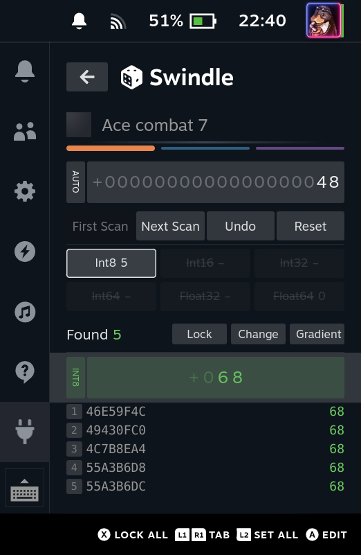

# Swindle

A memory scanner for the Steam Deck. You don't have to guess the type of a value: it is searched as Int8, Int16, Int32, Int64, Float32 and Float64 at once.

> Based on [Reroll](https://github.com/kayon/decky-reroll) by [Kayon](https://github.com/kayon), itself inspired by [Memory Deck](https://github.com/CameronRedmore/memory-deck). GPL v3, like the original.

## Features
- Every type at once, in a single pass over the game memory. Drop the wrong types with `Y`.
- Three searches side by side (the colored lines), switched with `L1` / `R1`.
- Lock values (one result or all), write negative values, write a gradient (87, 86, 85...) to tell addresses apart.
- Finds the running game by itself. Emulator mode for Yuzu, Ryujinx...
- Three big searches (several million results each) used about 330 MB on a Deck with a game running.

## Use
1. Type the value with the roller (`▲ ▼` digit, `◀ ▶` move, first slot is the sign).
2. `R2`: first scan. Each type shows how many results it found.
3. Change the value in the game, type it again, `R2`: next scan. Repeat until a few results are left.
4. `A` on a result writes the value of the green roller there.

## Controls
| Button | Action |
| --- | --- |
| `R2` | First / next scan (not from the green zone) |
| `L1` `R1` | Previous / next search |
| `Y` on a type chip | Keep only this type |
| `X` on a result | Lock / unlock it |
| `X` on the green roller | Lock all / unlock all |
| `L2` on the green roller | Write the value over all results |
| `L4` on the green roller | Write a gradient (the sign is kept, stops at 0) |

## Install
Not on the Decky Store yet. Build the zip (below), copy it to the Deck, then in Decky Loader (Developer mode) use *Install Plugin from Zip*.

## Build
- Frontend: `pnpm install && pnpm run build`. Tests: `pnpm test`.
- Plugin zip: on Linux with Docker, `make SHELL=/bin/bash setup` once, then `sudo ./cli/decky plugin build .`. The engine is in [backend/memscan](backend/memscan).

It needs root to read the memory of native games. Nothing is found? Click the game name and pick the process by hand.

## Credits
- [Kayon](https://github.com/kayon): Reroll and [memscan](https://github.com/kayon/memscan), the base of this project.
- [EcthorSilva](https://github.com/EcthorSilva): value locking ([Reroll #6](https://github.com/kayon/decky-reroll/pull/6)).
- [maosasagawa](https://github.com/maosasagawa): emulator mode ([Reroll #9](https://github.com/kayon/decky-reroll/pull/9), [memscan #3](https://github.com/kayon/memscan/pull/3)) and two engine fixes ([#2](https://github.com/kayon/memscan/pull/2), [#1](https://github.com/kayon/memscan/pull/1)).
- Everything else: [naparuba](https://github.com/naparuba).

## License
GPL v3 ([LICENSE](LICENSE)), the engine keeps its own [LICENSE](backend/memscan/LICENSE). Template: [decky-plugin-template](https://github.com/SteamDeckHomebrew/decky-plugin-template) (BSD 3-Clause).

## Disclaimer
Use at your own risk. Editing memory can crash a game or get you banned. Offline / single-player only.
